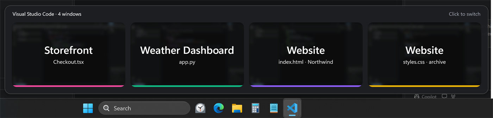
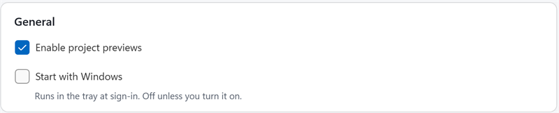
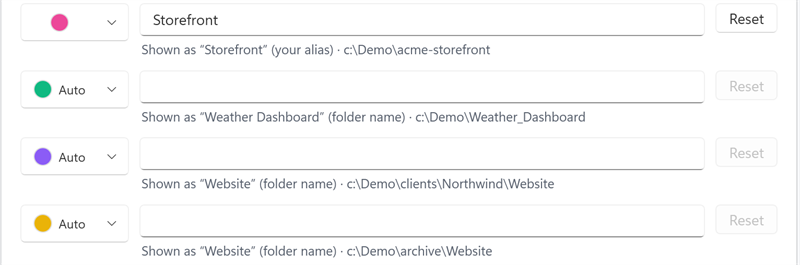
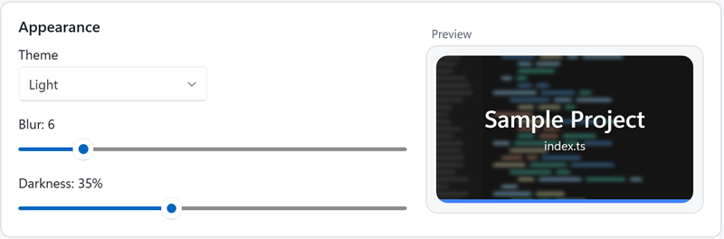
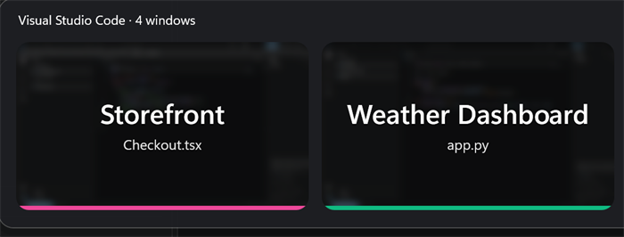
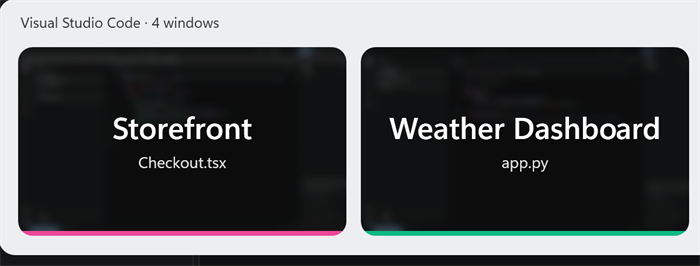
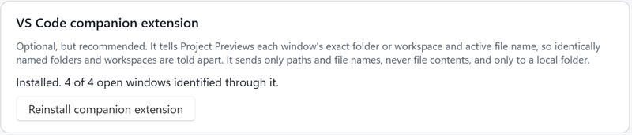

# Project Previews

**Find the right VS Code window at a glance.**

When several VS Code windows are open, Windows' taskbar previews all look alike and their titles are cut off.
Project Previews replaces that guesswork with large, readable project names. Rest your pointer on the VS Code icon
in the taskbar, then click the project you want.



*Resting the pointer on the VS Code taskbar icon (highlighted, bottom) opens the picker. Each card is one VS Code
window: its project name, the file it has open, and a blurred preview of the window behind them. Demo projects,
with blur and darkness turned down slightly from the defaults.*

**Contents:** [Quick start](#quick-start) · [Everyday use](#everyday-use) · [Changing names and looks](#changing-names-and-looks) ·
[Companion extension](#optional-the-vs-code-companion-extension) · [Turning it off](#turning-it-off-and-uninstalling) ·
[Troubleshooting](#troubleshooting) · [Limitations](#known-limitations) · [Privacy](#privacy) ·
[Technical reference](docs/TECHNICAL_REFERENCE.md)

## Quick start

**You need:**

- Windows 11 (64-bit). Windows 10 may work but hasn't been tested.
- VS Code (the regular version, not Insiders).
- The free **.NET 9 Desktop Runtime**. If it's missing, the app shows a message pointing to the download.
- No administrator rights.

**To start it:**

1. Run `ProjectPreviews.exe`. In this project it's `publish\ProjectPreviews\ProjectPreviews.exe`; you can also
   unzip `dist\ProjectPreviews-1.0.0-win-x64.zip` into any folder and run it from there. Nothing gets installed.
2. The first time, the **Settings** window opens. You can close it; the defaults are fine.
3. Project Previews keeps running in the background with a **tray icon**: a small icon in the notification area at
   the right end of the taskbar. If you don't see it, click the **^** arrow there.
4. Rest your pointer on the VS Code icon in the taskbar, without clicking. After a moment the picker appears.
   Click a card to switch to that window.

The app runs only once at a time. Starting it again while it's already running just opens its Settings.

## Everyday use

The **picker** is the popup of cards. Each card is one open VS Code window, labeled with its project's
**alias** (the friendly name shown on the card) and, underneath, the file that window has open.

| To… | Do this |
| --- | --- |
| Open the picker | Rest the pointer on the VS Code taskbar icon, **or** press **Ctrl+Alt+Space**, **or** left-click the tray icon |
| Switch to a window | Click its card. A minimized window is restored. |
| Use the keyboard | After opening it with the shortcut or tray icon: arrow keys (or Tab) to move, **Enter** to switch |
| Close the picker | Press **Esc**, click somewhere else, or move the pointer away |
| Reach VS Code's normal taskbar menu | Right-click the VS Code icon, even while the picker is open |

Opened by hovering, the picker doesn't take keyboard focus, so your typing still goes to the window you were using.
Clicking the VS Code icon while the picker is open gives the picker keyboard focus. With only one VS Code window,
that click minimizes or restores it, as usual.

Cards also help tell similar windows apart:

- **"1 of 2" / "2 of 2"** badges mean two windows have the same project open.
- **"· Northwind" / "· archive"** after the file name means two *different* folders have the same name; the
  card shows each one's parent folder.
- **Minimized** windows show a colored card instead of a preview.

### Tray icon menu

Right-click the tray icon for these options:

| Menu item | What it does |
| --- | --- |
| **Disable previews** / **Enable previews** | Pauses or resumes Project Previews. While disabled, the taskbar behaves exactly as normal and the shortcut does nothing, but the app stays running so you can turn it back on. |
| **Open window picker** | Opens the picker in the middle of the screen. |
| **Settings…** | Opens the Settings window. This is different from the picker. |
| **Exit** | Quits the app completely and removes the tray icon. |

## Changing names and looks

Everything here is in **Settings** (tray icon → Settings…).



*General: the main on/off switch, and whether the app starts when you sign in to Windows (off unless you turn it on).*

### Project names

By default a card shows the **folder name**, with underscores turned into spaces (`Weather_Dashboard` →
"Weather Dashboard"). If you use Claude Workers (AI Status Indicator), its project aliases are used automatically.

To give a project its own name, type it into that project's box in **Projects and aliases**. The name applies
to that exact folder only, so two folders that are both called `Website` can have different names. **Reset**
removes your name and color.



*Each row shows the name that will appear and where it comes from. Here the folder `acme-storefront` was renamed
"Storefront"; the others use their folder names.*

The colored dot next to each row sets the project's **accent color**, the stripe along the bottom of its card.
**Auto** picks a color that stays the same for that project.

### Theme, blur and darkness



*The sample card updates as you move the sliders. More blur makes the preview behind the name softer; more
darkness makes the name stand out more. Defaults: blur 10, darkness 45%.*

**Theme** can follow Windows (**System**) or be fixed to **Light** or **Dark**. The cards themselves stay dark
in both, so the white names remain readable:

| Dark | Light |
| --- | --- |
|  |  |

### Keyboard shortcut and hover

Under **How to open the picker** you can turn off hovering or the shortcut. To change the shortcut, click its
box and press the new combination; it must include Ctrl, Alt or Win. If another app is already using that
combination, Settings tells you.

## Optional: the VS Code companion extension

A VS Code **extension** is a small add-on that runs inside VS Code. The Project Previews **companion extension**
tells the app exactly which folder each VS Code window has open. Without it, the app has to work that out from
window titles, which contain only the folder's *name*.

| | Without the companion | With the companion |
| --- | --- | --- |
| Picker, switching, previews | ✓ | ✓ |
| Claude Workers aliases | ✓ | ✓ |
| Your own aliases | Only when no other folder VS Code knows about (open or recently open) has the same name | Always |
| Two folders with the same name | May be indistinguishable | Told apart |
| Multi-root workspaces | Name only, from the title | Identified by workspace file |
| Windows with a customized title | Shown as "Project not identified" | Identified |

**To install it**, open Settings and click **Install companion extension**. Or, in VS Code, run
*Extensions: Install from VSIX…* and choose `publish\ProjectPreviews\companion\project-previews-companion.vsix`.



When this was tested, VS Code windows that were already open picked it up within a few seconds without
reloading. If one doesn't, run *Developer: Reload Window* in that window.

The companion only shares folder paths and the *name* of the open file, never file contents, terminal output or
chats. It stays on your PC (no network). Details: [technical reference](docs/TECHNICAL_REFERENCE.md#the-companion-extension).

## Turning it off and uninstalling

**Pause it:** tray icon → **Disable previews**. Turn it back on from the same menu.

**Quit it:** tray icon → **Exit**. It won't come back until you start it again, unless "Start with Windows" is on.

**Uninstall completely:**

1. If you turned on **Start with Windows**, open Settings and turn it off first. *(Missed this step? Delete the
   `ProjectPreviews` value under `HKCU\Software\Microsoft\Windows\CurrentVersion\Run`.)*
2. Tray icon → **Exit**.
3. In VS Code, uninstall **Project Previews Companion** from the Extensions view, or run
   `code --uninstall-extension projectpreviews.project-previews-companion`.
4. Delete the folder that contains `ProjectPreviews.exe`.
5. Delete the app's data folders: `%APPDATA%\ProjectPreviews` (settings) and `%LOCALAPPDATA%\ProjectPreviews`
   (window reports, plus the debug log if you ever turned it on).

Those are the only places Project Previews writes to (see
[Files and registry](docs/TECHNICAL_REFERENCE.md#files-and-registry)). Claude Workers' alias file and VS Code's
own settings are only read, never changed.

## Troubleshooting

| Problem | Try this |
| --- | --- |
| Nothing appears when I hover | Keep the pointer still on the VS Code icon for a moment. Check the tray icon menu says **Disable previews** (meaning it's on) and that hovering is enabled in Settings. The shortcut and tray icon still work if hovering doesn't. |
| Windows' own small previews appeared instead | This can happen once, for example while the app is still starting. Move the pointer off the icon and back. |
| I can't find the tray icon | Click the **^** arrow at the right end of the taskbar. Or start `ProjectPreviews.exe` again, which opens Settings. |
| The shortcut does nothing | Another app may use the same combination; Settings shows a message if so. Pick a different one. |
| A name is wrong or says "Project not identified" | Install the [companion extension](#optional-the-vs-code-companion-extension), or set an alias in Settings. |
| A Claude Workers alias isn't used | Claude Workers aliases match the folder *name* exactly (case doesn't matter). An alias you set in Project Previews wins over it. |
| Clicking a card didn't bring the window forward | Windows sometimes blocks apps from switching windows. The picker says so and the window's taskbar button flashes; click that button. |
| A card has no preview | Minimized windows, and windows that couldn't be captured, show a colored card instead. |
| Settings shows a notice that settings were reset | The settings file was damaged. A copy was kept as `settings.corrupt-<date>.json` in `%APPDATA%\ProjectPreviews`. |
| Windows from another virtual desktop are missing | By design: the picker shows the windows on your current desktop, like the taskbar. |

For a detailed log of hover timing, see [Diagnostics](docs/TECHNICAL_REFERENCE.md#diagnostics).

## Known limitations

- **It's an overlay, not a change to Windows.** Windows doesn't let one app replace another app's taskbar
  previews. So Project Previews shows its own popup on top and, while it's open, briefly covers the VS Code icon so
  Windows cancels its own preview. No Windows settings are changed. This relies on how the Windows 11 taskbar
  behaves today, and a future Windows update could affect it. The shortcut and tray icon would keep working.
- **VS Code only.** VS Code Insiders, VSCodium, Cursor and other editors aren't included yet.
- **Tested on one setup.** Testing covered Windows 11 on a single high-resolution monitor at 200% scaling with the
  taskbar at the bottom. Multiple monitors, mixed scaling, Windows 10, and taskbars on other edges or set to
  auto-hide are handled in the code but haven't been tested. The full list is in the
  [technical reference](docs/TECHNICAL_REFERENCE.md#tested-configurations).
- If you move the app to another folder after turning on **Start with Windows**, turn that option on again.

## Privacy

No account, no internet connection, no analytics and no AI calls. Window previews are captured only while the
picker is open, kept in memory (never saved to disk), and discarded when you disable the app.

## For developers

- **[Technical reference](docs/TECHNICAL_REFERENCE.md)**: requirements, files and registry, alias and identity
  rules, the companion extension, taskbar integration, interaction details, tested configurations, building, and
  diagnostics.
- **[Implementation notes](IMPLEMENTATION_NOTES.md)**: architecture, design decisions, measurements and the
  validation log.

Quick build (needs the .NET 9 SDK and PowerShell 7; exit the app first):

```powershell
pwsh tools\build.ps1                      # companion .vsix, unit tests, Release exe, dist\*.zip
dotnet test tests\ProjectPreviews.Tests   # unit tests only
```
